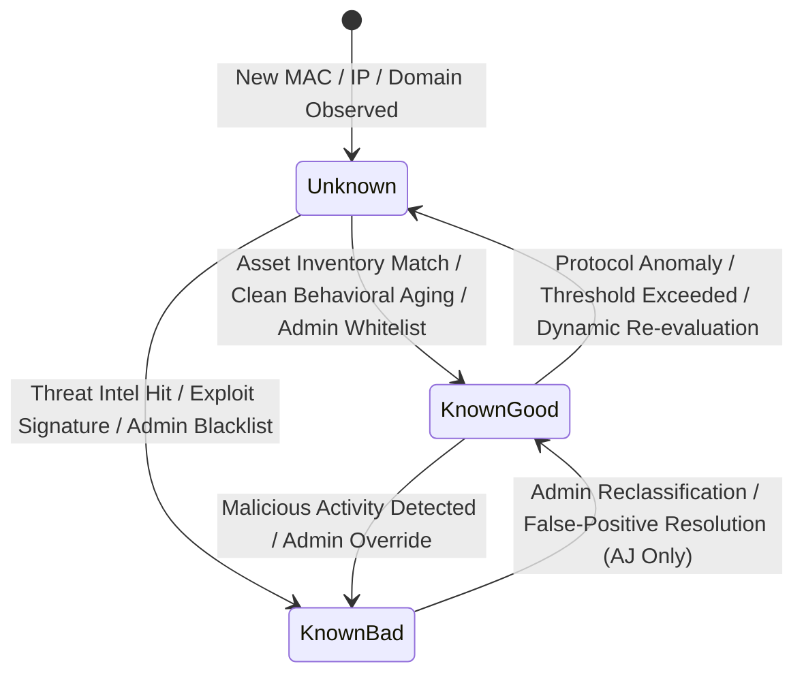
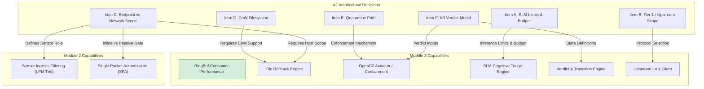

# Johnny Architecture Pass: Decision Brief
Superseded for decided items by docs/architecture/architecture-rev2.md (AJ decisions 2026-11-14); open items there remain AJ decides.  
Rev 3, 2026-11-14 America/Chicago (Rev 3: review 2 fixes; Decision 1 note).  
Status: **DRAFT — options only, every item AJ decision pending; nothing applied; nothing runs on Johnny.**

---

## 1. Where We Are

Module 1 passive SPAN sniffing is complete and verified on Johnny (verified at the 21:32Z window, week test in progress):
- **Kernel fast path (`eno1np0`):** Native-XDP driver mode program `j_xdp_records` (`prog_id=78`, `docs/findings/module1-slice2b/2026-11-12-cold-boot-verify.md:48`; verified object `docs/tool-install/module1-xdp-records.o` sha256 `a73c5bd2...`, `docs/findings/module1-slice2b/2026-11-12-cold-boot-verify.md:24`) attached to `eno1np0` (E810 SFP+7 mirror target DAC from MikroTik CRS309). Generates 80-byte header-only records (`struct m2_rec`, `docs/tool-install/module1_xdp_records.c:133-165`; version 1, `docs/tool-install/module1_xdp_records.c:78`) into kernel BPF ring buffer `m2_rb` (4 MiB, `docs/tool-install/module1_xdp_records.c:80`, `:218-221`).
- **Userspace reader:** Persistent service `johnny-m1s2b-reader.service` (`etc/systemd/system/johnny-m1s2b-reader.service` sha256 `e5c16249...`) executing `docs/tool-install/johnny-m1s2b-reader.py` (sha256 `476cf867...`). Drains `m2_rb` continuously and writes binary records to `/var/lib/johnny/m1s2b/run-<UTC>.bin` (`docs/tool-install/module1-slice2b-boot-unit.md:41`).
- **Retention settings:** Applied and verified 2026-11-14 19:18Z (`M1S2B-RET-VERIFY-DONE`, rev 113). Rotates at 1 GiB or 3600 s; directory cap 200 GiB; `keep=200` files; 100 GiB free disk reserve floor; `MemoryMax=1G` (`docs/os-handoff.md:17, 36-39`, `docs/findings/module1-slice2b/README.md:12`).
- **Rate-limit removal & baseline:** Applied and verified 2026-11-14 21:32Z (`M1S2B-NORC-VERIFY-DONE`, rev 114/115). Per-CPU token bucket config map `m2_cfg` updated to compiled maxima `ver=1 sample_every=1 rate=1000000 burst=100000` (`docs/os-handoff.md:19-22`) via boot helper `docs/tool-install/module1-slice2b-boot.sh` (sha256 `a4d4dfa4...`). Verification window (60 s) confirmed 32,812 packets seen and 32,812 emitted with 0 `rate_limited`, 0 `rb_full`, and 0 `discarded` drop deltas (`docs/os-handoff.md:3-10`; apply transcript `docs/findings/module1-slice2b-no-ratecap/2026-11-14-apply-output.md:58-67`).
- **Active validation gate:** A 7-day uninterrupted capture test is currently running on Johnny. Paste W (`boot.sh week`) is due only after **2026-11-21 15:33 CT (21:33Z)** (`docs/tool-install/module1-slice2b-boot-unit.md:3`, `docs/os-handoff.md:10`, runbook fence `docs/tool-install/module1-slice2b-boot-unit.md:583-596`). No scripts, systemd units, reboots, or manual commands may touch Johnny before that validation gate completes.

---

## 2. Core Decisions for AJ (agent-team §7 Items 2–7)

### Item A: SLM Limits and Autonomy (§7.2)

- **Question:** Should the on-box Small Language Model (SLM) be permitted to autonomously relax security tripwires and execute active containment verdicts, or should it be restricted to tighten-only adjustments and structured advisory scoring?
- **What the repo says:**
  - `docs/agent-team.md:260`: *"SLM limits: full function for now. The BEGIN doc lets the SLM relax thresholds; the architecture summary §4 says tighten-only, schema-bound risk scores, never run commands. AJ: models have full function for now; any limits come with the architecture pass. README and AGENTS.md say so."*
  - `docs/agent-team.md:85`: *"runtime-control: issue verdicts and adjust thresholds at runtime, tighter or looser (full function for now); the Daemon applies them."*
  - `docs/BEGIN_Network_Security_Software_Enterprise.md:4734-4737`: *"if it sees a developer compiling code in /home/dev/build, it instructs the eBPF map to relax $\chi^2$ and entropy tripwires for that directory. If a browser spawns an unknown shell, it tightens the math thresholds to maximum sensitivity."*
  - `docs/JOHNNY_ Executive Architectural Summary.md:166`: *"Adversarial Prompt Injection (MITRE ATLAS AML.T0051): Attackers may embed prompt-injection strings inside filenames or CLI args (execve) to hijack the local SLM into outputting an ALLOW verdict. Neuro-Symbolic Grammar Confinement: Input strings are tokenized as isolated data arrays; the SLM is constrained via finite-state logit masking to emit only bounded numerical risk vectors, and can tighten (never override Known-Bad or disable CoW) kernel map states."*
  - `README.md:25`: *"Stack fits 32 GB: Suricata + Zeek + own daemon + ClickHouse or Postgres/Timescale. No Elastic/OpenSearch. On-box SLM not yet budgeted."*
  - `docs/os-handoff.md:405`: *"Memory 19–20% used at idle (6.2 GB): userspace+slab+cache ≈ 0.5 GB; ~5.7 GB is direct kernel/driver allocation. Deferred to Module 1 sizing."*
- **Facts and constraints:**
  - Host RAM is 32 GB DDR5 (single channel, 4800 MT/s) (`README.md:8`).
  - Baseline memory consumption at idle is already ~6.2 GB (~5.7 GB direct kernel allocation) (`docs/os-handoff.md:405`). The remaining RAM must accommodate Suricata, Zeek, persistent storage (ClickHouse/Timescale), OS page cache, and userspace daemons.
  - `README.md:25` records that the 32 GB stack is planned for Suricata + Zeek + own daemon + ClickHouse or Postgres/Timescale, and the on-box SLM is not yet budgeted. The summary `:7` mentions "4-bit quantized" and `docs/BEGIN_Network_Security_Software_Enterprise.md:4720` mentions "e.g., Qwen-1.5B", without documenting resident memory bands or dynamic KV cache footprints in the repo. Whether an on-box SLM fits within the remaining memory alongside the rest of the stack without OOM risk is an unverified assumption.
  - Processing untrusted network inputs (such as DNS names, HTTP headers, or payload snippets) exposes an LLM/SLM to Indirect Prompt Injection (MITRE ATLAS [AML.T0051](https://atlas.mitre.org/techniques/AML.T0051), applied here to network payloads as noted in summary `:166`). If the model has authority to relax thresholds or classify traffic as Known-Good, an injection attack can induce deliberate blind spots.
  - CPUs 1–4 are pinned for packet capture queues (`README.md:18`, `docs/os-handoff.md:201, 289`). SLM inference must execute on remaining general-purpose cores without starving network ingest or disk persistence.
- **Options:**
  - **Option 1: Tighten-only mathematical tripwires and advisory scoring (Summary §4 model).** The SLM receives extracted metadata and outputs bounded numerical anomaly scores. It may request tighter thresholds (e.g., lower entropy trigger, heightened monitoring) or flag flows for review, but cannot lower thresholds, whitelist entities, override Known-Bad states, or execute system commands.
    - *Pros:* Fully neutralizes prompt injection threat of downgrading security; deterministic kernel tripwires remain sovereign; predictable compute profile.
    - *Cons:* Cannot automatically suppress recurring false positives without administrator intervention.
    - *Cost:* Low complexity; modest memory budget.
    - *Unblocks:* Safe user-space daemon integration without risk of model-induced bypass.
  - **Option 2: Bidirectional threshold tuning and autonomous state transitions (BEGIN doc model).** The SLM can dynamically tighten and relax kernel thresholds, and autonomously command state transitions (e.g. promoting Unknown to Known-Good or Known-Bad).
    - *Pros:* Maximizes autonomous adaptation; suppresses noise from benign developer or administrative activity.
    - *Cons:* High security risk; vulnerable to adversarial prompt injection; unpredictable feedback loops.
    - *Cost:* Requires complex grammar confinement, audit logging, and safety boundary enforcement.
    - *Blocks:* Provable deterministic safety properties; increases risk of false negatives.
  - **Option 3: Off-box SLM / Split execution (Security Onion / MAX model).** Remove the SLM runtime from Johnny entirely. Johnny acts as an ultra-lean sensor/enforcer, streaming anomalous metadata over a LAN channel to the MAX (`README.md:26`, `docs/agent-team.md:264`) for heavy model inference.
    - *Pros:* Zero impact on Johnny's 32 GB RAM and CPU cores; permits running larger models on workstation hardware.
    - *Cons:* Dependent on LAN connectivity to the external host; introduces network round-trip latency for cognitive triage.
    - *Cost:* Low on-box cost; needs a LAN channel to the MAX (schema and interface per §4).
    - *Unblocks:* Frees maximum host resources for capture, Suricata, Zeek, and local storage.
- **Recommendation:** **Option 1 (Tighten-only and advisory scoring).** Enforces strict neuro-symbolic separation: the model can escalate suspicion but cannot downgrade defenses or blind the fast path.
- **AJ decision pending.** **AJ decides.**

---

### Item B: Tier 1 Fleet / Global Cloud / Cross-Tenant Scope (§7.3)

- **Question:** Should Johnny implement or plan for Tier 1 global cloud / multi-tenant fleet features (IETF MLS RFC 9420, TreeKEM, cross-tenant Threat Graph), or remain strictly scoped to a single-node appliance reporting to an upstream LAN host (the MAX)?
- **What the repo says:**
  - `docs/agent-team.md:264`: *"Tier 1 (global cloud, cross-tenant, MLS fleet keying). No agent until a fleet exists. Assumption: upstream stays the MAX over the LAN (README)."*
  - `docs/JOHNNY_ Executive Architectural Summary.md:10-18, 49`: *"TIER 1: GLOBAL CLOUD CONTROL PLANE (PDP / XDR FABRIC)... Cross-Tenant Subgraph Isomorphism (IOAs)... OpenC2 Directives / MLS (RFC 9420)... TreeKEM group keying for fleet-wide IOA rule distribution."*
  - `README.md:3, 26`: *"Johnny: defensive network-security platform (monitoring, threat detection, response). First deployment is a 24/7 sensor watching the home LAN."* *"LLM triage over the LAN to the MAX: unchanged."*
- **Facts and constraints:**
  - Johnny is physically a single appliance (`aj-johnny`, 192.168.50.152) monitoring a single residential LAN switch (`docs/network-map.md:1-17`).
  - No fleet exists, no cloud backend exists, and there are no multi-tenant environments in this deployment.
  - RFC 9420 ([Messaging Layer Security / MLS](https://www.rfc-editor.org/rfc/rfc9420.html)) is an asynchronous group key agreement protocol designed for scalable multi-party messaging. Implementing MLS TreeKEM on a 1-to-1 point-to-point link over a private LAN adds massive cryptographic and protocol overhead with zero security benefit over standard mutual TLS (mTLS, RFC 8446 [RFC 8446](https://www.rfc-editor.org/rfc/rfc8446.html)) or WireGuard.
- **Options:**
  - **Option 1: Scope upstream transport strictly to point-to-point LAN channels (mTLS or WireGuard).** Formally drop Tier 1 cloud/fleet features (MLS RFC 9420, cross-tenant correlation) from Johnny's implementation scope. Upstream telemetry connects directly to the MAX over authenticated, encrypted LAN channels.
    - *Pros:* Eliminates unnecessary enterprise distributed-systems complexity; uses battle-tested protocols; keeps daemon focused on local defense.
    - *Cons:* Does not provide multi-node group keying if a distributed sensor fleet is deployed in the future.
    - *Cost:* Minimal.
    - *Unblocks:* Immediate, clean interface definition between Johnny and the MAX.
  - **Option 2: Retain Tier 1 concepts in documentation, but stub the upstream client.** Preserve Tier 1 architectural interfaces as future specifications, but implement only a LAN client (encoding and interface per §4).
    - *Pros:* Keeps the theoretical door open for cloud expansion without building it now.
    - *Cons:* Carries architectural baggage and unused abstraction layers.
    - *Cost:* Low build cost, moderate cognitive debt.
    - *Unblocks:* Immediate development while deferring protocol finalization.
  - **Option 3: Full implementation of Tier 1 cloud control plane and RFC 9420 MLS.** Build TreeKEM key management and multi-tenant threat graph synchronization.
    - *Pros:* Matches the full theoretical vision in the Executive Summary.
    - *Cons:* Extreme engineering waste for a single home-LAN appliance; burns memory, storage, and developer effort.
    - *Cost:* Prohibitive.
    - *Blocks:* Progress on core detection, parsing, and analysis modules.
- **Recommendation:** **Option 1 (Point-to-point LAN mTLS/WireGuard).** Pragmatic engineering: secure the actual link to the MAX using standard mTLS or WireGuard, dropping multi-tenant fleet overhead until an actual multi-node fleet is funded and deployed.
- **AJ decision pending.** **AJ decides.**

---

### Item C: Endpoint vs. Network Scope of Module 1 (§7.4)

- **Question:** Should Johnny remain strictly a network sensor (monitoring mirrored SPAN traffic), or should it also implement host-side endpoint sensing (BPF-LSM process tracking, `vfs_write` entropy math, file journaling) on Johnny itself, or require endpoint agents installed on other LAN hosts?
- **What the repo says:**
  - `docs/agent-team.md:265`: *"Endpoint vs network. The summary's Module 1 is host-side (BPF-LSM exec, `vfs_write` entropy, CoW rollback); Johnny's first job is a passive SPAN sensor, and README Module 1 is 'eBPF fast path'. Fast Path holds both XDP and LSM skills, so the roster works either way."*
  - `docs/JOHNNY_ Executive Architectural Summary.md:31-38`: *"TIER 3: DETERMINISTIC KERNEL FAST-PATH... Execution & Lineage (LSM) bprm_check_security... Storage Filter (VFS Hook) fentry/vfs_write... Fixed-Point H(B) & \chi^2... CoW FICLONE Trigger"*
  - `README.md:20`: *"Module 1: eBPF fast path — port-mirror sniffing COMPLETE... retention applied 2026-11-14 19:18Z; rate cap raised to cfg 1000000/100000 applied 2026-11-14 21:32Z; week test running to 2026-11-21 15:33 CT; optional future add-ons not started: symmetric RSS, AF_XDP; host LSM deferred to the architecture pass"*
  - `docs/findings/overseer-review-os-gate.md:§8`: Overseer gate approval signed by AJ (2026-11-05) confirmed: *"Module 1 first slice: passive SPAN / XDP path, host LSM deferred to the architecture pass"*.
  - *Note on documentation alignment:* Earlier draft text in `README.md:20` and `docs/findings/module1-slice2b/README.md:13` that described retention or rate cap changes as drafted has been updated to reflect the applied 2026-11-14 live state.
- **Facts and constraints:**
  - **Physical topology:** Johnny connects to switch SFP+7 via a 10G DAC cable (`docs/network-map.md:15`). SFP+7 receives mirrored ingress traffic from configured mirror sources SFP+1 (router), SFP+3 (bedroom; no link at the 2026-10-29 audit, `docs/network-map.md:11`), SFP+4 (rock-box), and SFP+5 (Framework) (`docs/network-map.md:9-15, 25`).
  - **Observation boundary:** Johnny sees Ethernet frames that cross the switch backplane. Johnny **cannot** observe system calls, file writes, memory allocations, or process executions occurring on the other LAN machines (rock-box, laptops, TVs, smart devices).
  - **LSM execution boundary:** Linux BPF-LSM hooks (`bprm_check_security`, `vfs_write`) operate strictly within the local host kernel where the code executes. If deployed on Johnny, they only monitor Johnny's own internal operating system processes (systemd, sshd, python reader, etc.), providing self-protection, **not** endpoint protection for the rest of the LAN.
  - **Kernel LSM prerequisites:** Linux BPF-LSM requires `CONFIG_BPF_LSM=y` compiled into the kernel, and the active LSM list must contain `bpf` (e.g. via `lsm=...,bpf` cmdline or kernel default build configuration) (see [Linux Kernel BPF LSM documentation](https://docs.kernel.org/bpf/bpf_lsm.html)).
  - Johnny's kernel is recorded as `7.0.0-42-generic` (`docs/os-handoff.md:84, 109`). In rev 98 (`docs/os-handoff.md:81`), kernel config `BPF_SYSCALL`, `XDP_SOCKETS`, `ICE`, and `BTF` were verified present. Whether `CONFIG_BPF_LSM=y` is compiled in and `bpf` is enabled in `lsm=` is not documented in repo logs. *To check after the week test, read-only.*
- **Options:**
  - **Option 1: Pure Network Sensor.** Scope Johnny purely as a dedicated network appliance. All fast-path eBPF resources focus on packet capture, protocol parsing, flow classification, and traffic metrics. Drop host-side BPF-LSM, process lineage, and `vfs_write` entropy hooks from Johnny.
    - *Pros:* Clean, cohesive product architecture matching physical hardware; zero risk of kernel panics or I/O stalls on Johnny's storage; maximizes CPU/memory for network analysis.
    - *Cons:* Does not provide endpoint-level visibility or ransomware file-rollback.
    - *Cost:* Low complexity; builds directly on completed Module 1 slice 2b.
    - *Unblocks:* Clean progression to network flow analysis, Suricata/Zeek integration, and Module 2/3 network parsing.
  - **Option 2: Dual Network Sensor + Johnny Appliance Self-Protection.** Implement BPF-LSM process tracking and VFS write monitoring locally on Johnny, strictly to protect Johnny's own operating system and capture logs from tampering.
    - *Pros:* Hardens the security appliance against local privilege escalation or tampering.
    - *Cons:* Does not protect endpoints on the LAN; adds kernel overhead and verification complexity to Johnny's OS.
    - *Cost:* Moderate engineering effort for narrow appliance self-protection.
    - *Unblocks:* Validates BPF-LSM concepts on the local box.
  - **Option 3: Distributed EDR Platform (Central Johnny Sensor + Remote Host Agents).** Reposition Johnny as the central collector and PDP, while writing separate lightweight endpoint agents (BPF-LSM on Linux, ETW/minifilters on Windows) to be deployed across rock-box, Framework, and other LAN workstations.
    - *Pros:* Achieves the complete hybrid network/endpoint vision outlined in the Executive Summary.
    - *Cons:* Multiplies project scope by an order of magnitude; requires cross-platform endpoint engineering, packaging, deployment, and ongoing maintenance.
    - *Cost:* Extremely high.
    - *Blocks:* Delays operational network monitoring and analysis while building endpoint software.
- **Recommendation:** **Option 1 (Pure Network Sensor).** Johnny's physical role and hardware investment (Minisforum MS-02 Ultra with Intel E810 25G capture NIC on SPAN mirror) is a network sensor. Trying to force host-level storage and process hooks onto a network appliance creates conceptual confusion and wasted effort.
- Note: a network-only sensor cannot reach Webroot or CrowdStrike class, because those products are host agents (see §5 gap row 1 and §7 Decision 1 note). Decision 1 Option C is the real path to that level; Decision 1 Option B is a cheap first step. AJ decides.
- **AJ decision pending.** **AJ decides.**

---

### Item D: Copy-on-Write (CoW) Filesystem Architecture (§7.5)

- **Question:** How should file-level Copy-on-Write (CoW) rollback be handled given Johnny's filesystem architecture, or does file rollback belong exclusively on managed endpoints?
- **What the repo says:**
  - `docs/agent-team.md:266`: *"CoW filesystem. The summary's CoW example names a btrfs snapshot; Johnny's root is XFS (FICLONE works only within one filesystem)."*
  - `docs/os-handoff.md:115`: *"Disk: CT1000P310SSD8: p1 ESP 1G `/boot/efi`; p2 2G ext4 `/boot`; p3 LUKS2 (aes-xts-plain64, argon2id) → LVM `ubuntu-vg` → `ubuntu-lv` 460G XFS `/`"*
  - `docs/os-handoff.md:326`: *"Carried from rev 2: headless; XFS root (FICLONE same-FS only); no snaps; no bond; STIG partition split deferred to fleet autoinstall"*
  - `docs/JOHNNY_ Executive Architectural Summary.md:6, 26, 150`: *"CoW transactional journaling (J) for state inversion... shadow_snapshot_id: cow-btrfs-inode-994821"*
- **Facts and constraints:**
  - **Reflink / FICLONE semantics:** The Linux `ioctl_ficlone` system call creates a copy-on-write reflink of an existing file, which is faster than a physical copy. The Linux VFS requires both the source and target files to reside on the same mounted filesystem (`docs/os-handoff.md:326`; `EXDEV` is returned if they are not on the same mounted filesystem, [ioctl_ficlone(2) manual](https://man7.org/linux/man-pages/man2/ioctl_ficlone.2.html)). FICLONE cannot clone files across different filesystems or across the network.
  - **Johnny's live filesystem:** Johnny's root `/` is formatted with XFS on LVM logical volume `ubuntu-lv` (460 GiB) over LUKS2 on NVMe (`docs/os-handoff.md:115`).
  - *Assumption:* Whether `reflink=1` is enabled on Johnny's XFS filesystem is not confirmed in the repository. *To check after the week test, read-only.*
  - *Assumption:* The amount of unallocated free space in LVM volume group `ubuntu-vg` is not documented in the repository. *To check after the week test, read-only.*
  - **Network isolation:** As established in Item C, Johnny cannot reflink or snapshot files residing on other machines on the LAN. File-level rollback on Johnny would only snapshot Johnny's own internal log files and system binaries.
- **Options:**
  - **Option 1: Drop on-box file rollback; recognize rollback as an endpoint capability.** Acknowledge that a network sensor does not perform host file modifications. Exclude VFS rollback from Johnny's codebase; reserve rollback engines for future endpoint agent implementations.
    - *Pros:* Eliminates dead code and architectural fiction; avoids risking filesystem corruption or disk exhaustion on Johnny.
    - *Cons:* The network sensor cannot undo ransomware damage on endpoints (which is physically impossible over SPAN anyway).
    - *Cost:* Zero.
    - *Unblocks:* Focuses storage architecture entirely on high-throughput telemetry ingestion (e.g. ClickHouse/Timescale).
  - **Option 2: Use XFS Reflink / FICLONE shadow copying on Johnny's existing filesystem.** If Johnny retains self-protection hooks, use `ioctl_ficlone` directly on the existing XFS `/` filesystem to snapshot critical files before write.
    - *Pros:* Works on the current installed filesystem without repartitioning or reformatting (subject to confirming `reflink=1`).
    - *Cons:* Scoped strictly to Johnny's local disk; adds complexity for minimal gain on an appliance.
    - *Cost:* Low-to-moderate.
    - *Unblocks:* Validates reflink mechanics on Linux.
  - **Option 3: Carve a dedicated Btrfs or ZFS volume from LVM.** Create a new logical volume formatted with Btrfs or ZFS specifically to support subvolume snapshotting.
    - *Pros:* Provides true filesystem snapshotting matching the summary's Btrfs example.
    - *Cons:* Requires repartitioning / LVM changes; Btrfs/ZFS adds kernel memory overhead; still only protects local files on Johnny.
    - *Cost:* High operational and maintenance cost.
    - *Blocks:* Requires risky storage reconfiguration on Johnny.
- **Recommendation:** **Option 1 (Drop on-box file rollback).** File-level CoW rollback is fundamentally an endpoint capability. Johnny is a network appliance; its storage should be optimized for append-only telemetry and database indexing, not file shadow-copying.
- **AJ decision pending.** **AJ decides.**

---

### Item E: Automated Network Quarantine Path (§7.6)

- **Question:** How should automated or semi-automated threat containment actions (e.g. OpenC2 `contain` directives) be executed against the physical network infrastructure?
- **What the repo says:**
  - `docs/agent-team.md:267`: *"Automated quarantine path. OpenC2 contain → MAC ACL/VLAN needs a way to reach the switch; the CRS309 is managed only from the laptop on ether1."*
  - `docs/agent-team.md:97`: *"response playbooks (CACAO style): when to quarantine by MAC ACL/VLAN, never port shutdown."*
  - `docs/agent-team.md:113`: *"quarantine-path: MAC ACL / VLAN quarantine on the CRS309, and how an automated response would reach the switch (§7.6)."*
  - `README.md:11, 28`: *"Switch: MikroTik CRS309-1G-8S+IN, RouterOS 7.23.8; managed only from a laptop on ether1."* *"Devices keyed by MAC/IP; quarantine by MAC ACL/VLAN, not port shutdown."*
  - `docs/network-map.md:8, 22-23`: *"ether1: AJ's laptop: OOB switch mgmt, switch side 192.168.88.1/24... Management: ether1 only... SSH + Winbox allowed from 192.168.88.0/24 only; www, api, api-ssl, telnet, ftp, reverse-proxy disabled; MAC server/MAC-Winbox and neighbor discovery on MGMT only... LAN address: DHCP client on bridge... ip-forward=no. Pingable from the LAN, not manageable from it."*
- **Facts and constraints:**
  - **Physical switch isolation:** The MikroTik CRS309 switch management plane is strictly out-of-band on `ether1` (192.168.88.1/24), cabled directly to AJ's laptop (`docs/network-map.md:8`).
  - **Management access locked down:** On the switch, Web, API, API-SSL, Telnet, and FTP are disabled. SSH and Winbox are restricted to the 192.168.88.0/24 subnet on `ether1` (`docs/network-map.md:22`). The switch's LAN bridge address (192.168.50.221) responds to ICMP ping but rejects all management connections (`docs/network-map.md:22-23`).
  - **Security risk of granting Johnny switch access:** If Johnny is granted automated write access to RouterOS (via SSH keys or REST API credentials), a compromise of Johnny's sensor or daemon would hand the attacker control over the physical switch fabric, enabling network-wide denial of service or traffic redirection.
  - **Router containment alternative:** The ASUS RT-BE88U router (192.168.50.1) handles all LAN-to-WAN routing and DHCP leases (`docs/network-map.md:41, 57-67`).
- **Options:**
  - **Option 1: Human-in-the-Loop Advisory (Johnny proposes, AJ executes).** Johnny detects threats and generates advisory MAC ACL or VLAN quarantine actions in accordance with repo rules (quarantine by MAC ACL or VLAN, never port shutdown, `README.md:28`, `docs/agent-team.md:97, 113`; exact RouterOS commands are not in this brief). AJ reviews and executes the action on the switch from the management console on the laptop.
    - *Pros:* Zero attack surface expansion; completely prevents rogue, bug-induced, or attacker-controlled switch reconfigurations; maintains switch management isolation (management only on `ether1`, not manageable from the LAN, `docs/network-map.md:22-23`).
    - *Cons:* Response latency depends on human intervention.
    - *Cost:* Low.
    - *Unblocks:* Immediate implementation of CACAO playbooks and alert workflows.
  - **Option 2: Dedicated out-of-band management link from Johnny to switch with restricted API user.** Cable Johnny's host management or a dedicated adapter to a dedicated management port or VLAN on the switch, enabling programmatic RouterOS API or SSH access restricted to MAC ACL or VLAN manipulation.
    - *Pros:* Fully automated network quarantine.
    - *Cons:* Breaches the current out-of-band security boundary; introduces switch credentials onto Johnny's disk; high risk if an SLM or rule misfires and isolates legitimate systems.
    - *Cost:* Moderate hardware and configuration effort.
    - *Blocks:* Simplicity; requires complex fail-safe and rollback mechanisms.
  - **Option 3: Upstream Gateway Containment on ASUS RT-BE88U Router.** Instead of touching the L2 switch, execute automated quarantine at the L3 gateway (ASUS router) via firewall rules or DHCP revocation to cut off external Internet egress.
    - *Pros:* Leaves the core L2 switch completely untouched; isolates infected hosts from WAN C2.
    - *Cons:* Does not stop lateral movement between hosts on the same L2 broadcast domain.
    - *Cost:* Requires establishing a secure API/SSH channel to the router.
    - *Unblocks:* WAN exfiltration containment.
  - **Option 4: Alert-Only (Zero Active Response).** Johnny operates purely as a passive monitoring, detection, and forensics platform with no automated or scripted response capabilities.
    - *Pros:* Absolute operational stability; zero false-positive disruption.
    - *Cons:* Relies entirely on manual incident response.
    - *Cost:* Lowest.
    - *Unblocks:* Fast progress on analytics and correlation.
- **Recommendation:** **Option 1 (Human-in-the-Loop Advisory).** Preserves the physical security architecture of the CRS309 switch. Generates structured OpenC2 and advisory MAC ACL / VLAN containment actions for AJ to execute, eliminating the risk of rogue switch lockouts.
- **AJ decision pending.** **AJ decides.**

---

### Item F: Kleene Strong Three-Valued Logic ($K_3$) Verdict Model (§7.7)

- **Question:** What verdict states, state transitions, and evidence thresholds should govern entity classification in Johnny's decision engine?
- **What the repo says:**
  - `docs/agent-team.md:268`: *"Verdict model. The K3 states and transitions are a draft (Architect verdict-model)."*
  - `docs/agent-team.md:54`: *"verdict-model: verdict states and transitions. The summary's three-valued K3 model (Known-Bad −1, Unknown 0, Known-Good +1) is the starting draft, not locked (§7)."*
  - `docs/JOHNNY_ Executive Architectural Summary.md:4, 87-94`: Kleene Strong Three-Valued Logic ($K_3$) process classification state:
    - `KnownBad = -1` (immediate inline -EPERM / SIGKILL + journal inversion)
    - `Unknown = 0` (supervised execution + CoW journaling + outbound net gate)
    - `KnownGood = +1` (zero-latency pass-through)
  - `docs/JOHNNY_ Executive Architectural Summary.md:70-75`: LTL invariants:
    - Containment of Indeterminate Processes (Exfiltration Prevention, `:70-71`):  
      $$\mathbf{G} \Big( (S(p) = 0 \land \text{NetConnect}(p, \text{dst})) \implies (\text{dst} \in \text{WhiteList} \lor \mathbf{X}\,\text{DropPacket}(p)) \Big)$$
    - Pre-Write Shadow Invariant (Non-Destructive Execution, `:72-73`):  
      $$\mathbf{G} \Big( (S(p) = 0 \land \text{VfsWrite}(p, f)) \implies (\text{CoWCloned}(f) \ \mathbf{\mathcal{U}} \ \text{Verdict}(p) \in \{+1, -1\}) \Big)$$
    - Algebraic Inversion Completeness (`:74-75`):  
      $$\mathbf{G} \Big( (S(p) = 0 \land \mathbf{F}(S(p) = -1)) \implies \mathbf{F} \big( \text{State}_{\text{host}} = S_0 + \sum_{k=t}^{1} \Delta_k^{-1} \big) \Big)$$
  - `docs/BEGIN_Network_Security_Software_Enterprise.md:50-65`: Webroot tri-categorization model: Known Good (allow), Known Bad (block immediately), Unknown (journal & monitor).
- **Facts and constraints:**
  - **Kleene logic semantics:** In mathematical Kleene logic ($K_3$), truth values are $\{True (+1), Unknown (0), False (-1)\}$. In the summary's draft, these states are defined over in-memory operating system processes ($p$).
  - **Passive SPAN boundary:** Because Johnny is attached as a passive SPAN sensor on `eno1np0`, an "Unknown" state cannot physically drop packets in-flight between other LAN endpoints.
  - **Proposed adaptation to network entities:** Whether $K_3$ states should be adapted to apply to network entities (MAC addresses, IP addresses, external domains, TLS certificates, flow tuples) rather than in-memory OS processes, and which actors hold transition authority, is an architectural proposal for AJ's determination.
- **Options:**
  - **Option 1: Proposed Adaptation: Strict 3-state $K_3$ model applied to Network Entities.** Adapts the pure Kleene tri-state domain ($\{+1, 0, -1\}$) from host processes to network traffic entities (MACs, IPs, domain names, tuples) with explicit transition authorities and single-exit administrative recovery from Known-Bad:

| Current State | Input / Event | New State | Authorized Transition Actor | Action / Effect |
|---|---|---|---|---|
| **Unknown ($0$)** | MAC matches approved asset inventory | **Known-Good ($+1$)** | Detection Engine / Asset DB | Baseline traffic logging; standard telemetry |
| **Unknown ($0$)** | External IP/domain in verified blocklist | **Known-Bad ($-1$)** | Fast-Path Rule / Intel Feed | High-priority alert; quarantine recommendation |
| **Unknown ($0$)** | SLM evaluates behavioral anomaly score $> \tau$ *(only if AJ picks Item A Option 1)* | **Unknown ($0$)** (Tuned) | SLM Cognitive Triage | Tightens math thresholds; raises alert priority |
| **Unknown ($0$)** | Clean observation window expires ($T_{age}$) | **Known-Good ($+1$)** | Daemon Aging Policy | Demotes monitoring intensity |
| **Known-Good ($+1$)** | Flow exceeds dynamic volume/rate anomaly | **Unknown ($0$)** | Fast-Path Tripwire | Re-engages deep inspection and flow logging |
| **Known-Good ($+1$)** | Signature exploit match (Suricata/Zeek) | **Known-Bad ($-1$)** | Detection Engine | Generates containment proposal; alert raised |
| **Known-Bad ($-1$)** | False positive resolution | **Known-Good ($+1$)** | **AJ Only** (Manual Override) | Clears quarantine; updates whitelist |

    - *Pros:* Mathematically clean; minimal state space; cleanly adapts the summary's tri-state logic to network traffic entities; single unambiguous exit from Known-Bad via AJ override.
    - *Cons:* Does not differentiate between tentatively clean and cryptographically verified good devices.
    - *Cost:* Low complexity.
    - *Unblocks:* Unified verdict engine implementation in the daemon.
  - **Option 2: 5-state Extended Lifecycle Model.** Expands states to: *Verified-Good*, *Observed-Benign*, *Indeterminate/Unknown*, *Suspicious*, *Confirmed-Malicious*.
    - *Pros:* Finer granularity for triage queues and dynamic threshold adjustments.
    - *Cons:* Significant state machine complexity; potential for transition edge-case deadlocks.
    - *Cost:* Moderate-to-high.
    - *Blocks:* Delays verdict engine implementation.
  - **Option 3: Static Allow/Deny List (Binary 2-State).** Abandon $K_3$ logic; implement standard binary allow/deny firewall logic.
    - *Pros:* Simple and conventional.
    - *Cons:* Loses the entire architectural concept of supervised, indeterminate execution.
    - *Cost:* Low.
    - *Blocks:* Defeats core project architectural design.
- **Recommendation:** **Option 1 (Proposed Adaptation: Strict 3-state $K_3$ model applied to Network Entities).** Preserves the formal foundation of $K_3$ logic while cleanly adapting it to network traffic entities with strict transition authority and single-path administrative override.
- **AJ decision pending.** **AJ decides.**

---

## 3. How Modules 2 and 3 Depend on These Decisions

This section maps **capability dependencies only** (which policy decisions block which operational capabilities). It does not specify or constrain code structure, languages, or software design.

### Module 2 (Ingress Mediation & Packet Validation)
*Repo references: `docs/JOHNNY_ Executive Architectural Summary.md:174-175`, `README.md:20`, `docs/agent-team.md:67-68`.*
- **LPM-Trie Prefix Filtering Capability:**
  - *Dependency:* Dependent on **Item C (Scope)**. In a passive SPAN deployment, an LPM trie filters what Johnny's kernel passes up to userspace analyzers. In an inline deployment, it actively blocks transit traffic.
  - *Status:* Independent of Items A, B, D, E, F. Can proceed as soon as network ingest filtering criteria are defined.
- **Single Packet Authorization (SPA) Capability:**
  - *Finding / Dependency:* **Blocked on Item C (Scope: Inline vs. Passive).** In the summary, SPA gates inbound network access. However, because Johnny is currently attached as a passive SPAN listener on `eno1np0`, an XDP drop at Johnny's interface cannot block packets destined for other LAN hosts. Implementing SPA on Johnny only makes sense if SFP+8 is cabled inline or if SPA is used to protect Johnny's own management port (`eno3`).

### Module 3 (Userspace Processing, Triage, and Response)
*Repo references: `docs/JOHNNY_ Executive Architectural Summary.md:176`, `docs/agent-team.md:69-88`.*
- **Ring Buffer Consumer Performance Optimization:**
  - *Dependency:* **Largely INDEPENDENT of Decisions A–F.** Draining `m2_rb` at line rate without dropping records is an operational throughput capability independent of Decisions A–F; language and implementation choice per §4 question 2.
- **File Rollback Engine Capability:**
  - *Dependency:* **BLOCKED on Item C (Scope) and Item D (Filesystem).** If Johnny remains a pure network sensor (Item C Option 1), an on-box file rollback engine is out of scope and should not be built. If appliance self-protection is selected, it depends on the filesystem choice (Item D).
- **SLM Cognitive Triage Capability:**
  - *Dependency:* **BLOCKED on Item A (SLM Limits and Resource Budget).** Cannot be built until the model's authority (tighten-only vs. bidirectional) and resource budget are decided.
- **OpenC2 Actuator / Containment Capability:**
  - *Dependency:* **BLOCKED on Item E (Quarantine Path), Item F (Verdict Model), and Item A (SLM Limits).** The response actuator cannot be built without knowing how containment reaches the network (advisory vs. automated switch access) and what states trigger action.
- **Verdict and State Transition Engine Capability:**
  - *Dependency:* **BLOCKED on Item F (Verdict Model).** The core logic engine requires a locked state machine specification ($K_3$ vs. extended) and transition authority rules.
- **Upstream Client Capability:**
  - *Dependency:* **BLOCKED on Item B (Tier 1 / Upstream Scope).** Requires deciding between point-to-point LAN channels (mTLS or WireGuard) vs. enterprise MLS TreeKEM.

---

## 4. Code-Shape Questions for AJ

The following architectural and engineering questions define the shape, boundaries, languages, and structure of the code. In accordance with project steering, these questions are presented for AJ's determination without recommendations:

1. **Module Boundaries & Daemon Architecture:**
   - Should userspace processing run as a single consolidated daemon (handling ringbuf ingest, protocol parsing, verdict evaluation, storage persistence, and triage), or be decomposed into multiple cooperating daemons/services (e.g. separate ingest service, analysis engine, and response actuator)?
2. **Implementation Languages:**
   - Which languages and runtimes shall be used for each component across userspace consumers, analysis engines, database interfaces, and CLI tooling?
3. **Kernel-to-Userspace BPF Libraries & Interfaces:**
   - Which framework shall be used for BPF map interaction and ring buffer consumption (e.g. `libbpf` C bindings, Rust `aya`, Rust `libbpf-rs`, or other)?
4. **Telemetry & Record Schema Evolution:**
   - How should telemetry records evolve beyond the current 80-byte `struct m2_rec` (e.g. versioned C structs, flatbuffers, protobuf, or zero-copy binary layouts) to accommodate extended protocol metadata without breaking storage pipelines?
5. **Storage & Database Selection:**
   - Which persistence backend shall store flow telemetry and security events on Johnny (e.g. ClickHouse, TimescaleDB/PostgreSQL, SQLite, or flat columnar files), and how will data retention be enforced?
6. **Repository Layout & Workspace Structure:**
   - How should the codebase be organized within the repository (e.g. Cargo workspace, multi-crate tree, separate subdirectories for kernel BPF vs. userspace vs. common types)?
7. **Build, Test, and Packaging Toolchain:**
   - How will BPF objects, userspace daemons, and detection configurations be built, tested, and packaged (e.g. standalone Makefiles, Cargo build scripts, hermetic CI containers, Debian packages)?
8. **Detection Content & Configuration Versioning:**
   - How should detection rules (Suricata signatures, Zeek scripts, threshold profiles, threat intel lists) be packaged, tested, versioned, and hot-reloaded into the running system?

---

## 5. Gaps vs. a Commercial EDR (Webroot / CrowdStrike Class)

A transparent, rigorous assessment of where Johnny's documented architecture and current implementation stand relative to commercial enterprise Endpoint Detection and Response (EDR) platforms:

| Domain | Johnny Repo Today | Commercial EDR Standard | Needs from AJ |
|---|---|---|---|
| **1. Host / Endpoint Telemetry** | **Mirrored network headers only.** Today Johnny captures 80-byte L2–L4 network headers on `eno1np0` (`module1_xdp_records.c`). No process trees, thread injection, memory allocations, or registry/file I/O from endpoints (`docs/findings/module1-slice2b/2026-11-12-cold-boot-verify.md`). | **Deep in-kernel endpoint instrumentation.** CrowdStrike Falcon uses a kernel sensor capturing process execution, thread injection, DLL loading, and registry mutations ([CrowdStrike Architecture](https://www.crowdstrike.com/wp-content/uploads/2020/11/CrowdStrike_Falcon_Platform_Architecture.pdf)). Webroot hooks system APIs and file I/O chains via `WRkrn.sys` (`docs/Security Software Architecture Overview.md:26-38`). | Decision on Item C: Will endpoint agents ever be built, or is Johnny strictly a network sensor? |
| **2. Detection Content Lifecycle** | **Static compiled limits & disabled Suricata.** Hardcoded token bucket (1M/100k); basic counter verification scripts. Suricata 8.0.3 installed (`docs/os-handoff.md:370`) but disabled/inactive (`docs/os-handoff.md:375`). No custom rules, automated rule deployment, or false-positive feedback loops. | **Continuous threat feed & behavioral rules.** Commercial EDRs maintain dynamic behavioral rule compilers, ML classification models updated multiple times daily, automated false-positive suppression, and STIX/TAXII threat intel integration. | Which primary detection engines (Suricata, Zeek, or custom daemon) should be prioritized, and how should rule updates be managed? |
| **3. Response & Rollback** | **Conceptual only.** Rollback exists as theoretical formulas ($S_0 = S_t + \sum \Delta_k^{-1}$ in `docs/JOHNNY_ Executive Architectural Summary.md:26`; $\text{State}_{\text{host}} = S_0 + \sum_{k=t}^{1} \Delta_k^{-1}$ in `docs/JOHNNY_ Executive Architectural Summary.md:75`). No rollback code exists in the repository. Switch quarantine blocked by out-of-band management (`docs/network-map.md:22-23`). | **Live transactional unwinding.** Webroot intercepts file writes into a transient shadow cache and unwinds registry/file modifications upon malicious verdict (`docs/BEGIN_Network_Security_Software_Enterprise.md:67-89`). Commercial EDRs provide automated host network containment. | Decisions on Items D and E: Should on-box file rollback be dropped, and should network quarantine be structured as an advisory workflow or automated switch control? |
| **4. Fleet Management & Enrollment** | **Single host, manual administration.** Exactly one node managed via manual SSH pastes and terminal console. No enrollment tokens, registration APIs, or fleet inventory. | **Automated multi-tenant agent orchestration.** Automated silent installer packages, cryptographic device enrollment (TPM/attestation), policy assignment by host group, and heartbeat monitoring across tens of thousands of endpoints. | Decision on Item B: Should Johnny be formally scoped to a single-node appliance reporting over LAN to the MAX, or is multi-node fleet orchestration required? |
| **5. Tamper Resistance & Self-Protection** | **Host OS hardened; userspace sandboxed via systemd.** Strong host foundation: Secure Boot, TPM2 PCR 7 LUKS, kernel lockdown, CIS Level 1 compliance (225 PASS, 18 PASS manual, 31 N/A, 0 FAIL, `docs/os-handoff.md:90`). Userspace reader runs under strict systemd hardening (`etc/systemd/system/johnny-m1s2b-reader.service:11, 32-41, 63`): `User=root`, `NoNewPrivileges=yes`, empty `CapabilityBoundingSet=` and `AmbientCapabilities=`, `ProtectSystem=strict`, `PrivateNetwork=yes`, `IPAddressDeny=any`, `ReadWritePaths=` restricted to ring pin and output directory, and `@system-service bpf` syscall filter. Remaining gap: no kernel anti-tamper protecting the daemon from root termination, not documented in the unit. | **Active kernel anti-tampering.** Commercial drivers actively intercept and block termination calls directed at security daemons, detect driver unloading attempts, and protect local event databases from tampering. | What additional tamper-resistance or process self-protection controls, if any, are required for userspace daemons beyond systemd sandboxing? |
| **6. Cloud & Threat-Intel Backend** | **None.** No cloud infrastructure, reputation lookups, or global intelligence directories exist in repo. | **Multi-petabyte graph correlation.** Webroot BrightCloud correlates 200+ TB of threat data (`docs/BEGIN_Network_Security_Software_Enterprise.md:13-17`) with low latency (<100 ms on broadband links, `docs/Security Software Architecture Overview.md:70`) across millions of endpoints (`docs/BEGIN_Network_Security_Software_Enterprise.md:42`). CrowdStrike Threat Graph correlates cross-tenant events in real time. | Which external threat intelligence feeds (STIX/TAXII, public blocklists, DNS feeds) should Johnny ingest locally? |
| **7. Scale, Storage & Search** | **Rotating binary header files.** Python reader writes binary header files to `/var/lib/johnny/m1s2b` with a 200 GiB directory cap (`docs/os-handoff.md:17, 39, 53`). No database, indexing, or structured query engine. | **Distributed indexed telemetry datastores.** High-performance databases and indexing engines handling billions of events per day with fast search and correlation. | Decision on Item 5 in §4: Which persistence engine (e.g. ClickHouse, TimescaleDB, SQLite, or flat columnar storage) should be selected for telemetry and event indexing? |
| **8. Operations & Triage UI** | **Command-line logs & grep only.** Operator visibility is limited to running `boot.sh status`, `journalctl`, and raw binary file dumps (`docs/tool-install/module1-slice2b-boot.sh`). No graphical interface, alert queue, or on-call paging. | **Unified SOC Management Console.** Rich web consoles with process tree visualization, alert triage queues, incident timeline reconstruction, and automated case management. | What operator interface (local terminal TUI, web UI, or headless log streaming to the MAX) should be built for alert review and triage? |
| **9. Testing & Evaluation** | **Synthesized local fixtures & bounded live runs.** Slice 2b verified via rock-box self-test fixtures (`module1-slice2b-self-test.sh`), a 60-second live verification window, and an active 7-day soak test. No live malware execution corpus or formal precision/recall evaluation. | **Automated live adversarial detonation.** Continuous automated testing against active malware corpora (e.g. VirusTotal samples), Atomic Red Team emulation, and formal regression benchmarking for false positive rates. | What attack emulation methodology (e.g. tcpreplay of attack PCAPs, nmap/snort benchmark sets) should be adopted for detection validation? |

---

## 6. Architectural Lock-In Risks

Choices that would be costly or disruptive to reverse once implemented:

1. **On-Disk Record Format (`struct m2_rec`):**
   - *The Risk:* Johnny currently writes run files containing a 96-byte versioned file header (`docs/tool-install/johnny-m1s2b-reader.py:58-63`: magic `JM1S2RB\0`, `HDR_VERSION = 1`, record size, record version, clock offset, `m2_cfg` snapshot, `m2_ctl` baseline sums) followed by 80-byte `struct m2_rec` binary records (`docs/tool-install/module1_xdp_records.c:133-165`). The 80-byte record already includes VLAN information (`vlan_tci` and `F_VLAN`/`F_VLAN_DEEP` flags, `docs/tool-install/module1_xdp_records.c:128, 142`), but lacks fields such as TCP window sizes or payload entropy. If downstream tools or databases depend directly on this 80-byte record layout, changing the record structure locks in or invalidates historical file archives.
2. **Kernel-to-Userspace BPF Map Layouts:**
   - *The Risk:* Changing map structures (`m2_cfg`, `m2_ctl`, `m2_rb`) requires simultaneous updates to both kernel BPF objects and userspace readers. While `docs/agent-team.md:52` and `docs/JOHNNY_ Executive Architectural Summary.md:77-98` note Rust `#[repr(C)]` layouts, AJ has not adopted Rust or a specific ABI framework (§4 questions 2 and 3 remain open decisions for AJ). The map layout itself is what couples kernel and userspace.
3. **Granting Programmatic Write Access to the Switch:**
   - *The Risk:* Exposing CRS309 RouterOS management credentials to Johnny creates a permanent lateral-movement risk. Once automated switch management is built into the daemon, rolling back to an out-of-band management model requires dismantling automated playbooks.
   - *Design Advice:* Favor human-in-the-loop advisory response until network trust models are fully proven.
4. **Filesystem Choice for Quarantine / Rollback:**
   - *The Risk:* Formatting partitions for Btrfs/ZFS or restructuring LVM thin pools commits Johnny's storage architecture. Reverting requires full partition rebuilds, filesystem backups, and risk to Secure Boot / LUKS enrollment.
   - *Design Advice:* Avoid repartitioning Johnny's 460 GiB XFS root volume unless absolutely mandatory.
5. **Fleet Keying & Upstream Transport Protocol:**
   - *The Risk:* Implementing RFC 9420 MLS TreeKEM locks the software into complex cryptographic state-machine libraries that are difficult to debug and maintain.
   - *Design Advice:* Standard point-to-point channels (mTLS or WireGuard) can easily be adapted or replaced later without protocol lock-in.

---

## 7. Decisions for AJ (in Order of Dependency)

The following decisions are arranged in logical order of dependency (each decision unblocks subsequent architectural choices). Each requires AJ's determination:

### Decision 1: Scope — Pure Network Sensor vs. Endpoint Agent (Item C)
- **Question:** Should Johnny remain strictly a network sensor (passive SPAN / future inline), or should host-side endpoint sensing (BPF-LSM / VFS hooks) be built on Johnny or other LAN endpoints?
- **Options:**
  - A. Pure Network Sensor (Johnny monitors mirrored network traffic only; drop host LSM/storage hooks).
  - B. Dual Network Sensor + Johnny Appliance Self-Protection (Network capture + local BPF-LSM on Johnny's OS only).
  - C. Full Distributed EDR (Network sensor + separate endpoint agents deployed to rock-box and other LAN hosts).
- **Recommendation:** **Option A** — Aligns with physical hardware, avoids building two separate products, and maximizes network monitoring efficiency.
- Note: a network-only sensor cannot reach Webroot or CrowdStrike class, because those products are host agents (see §5 gap row 1). Option C is the real path to that level; Option B is a cheap first step. AJ decides.
- **AJ decision pending.** **AJ decides.**

### Decision 2: Network Containment Authority & Management Path (Item E)
- **Question:** How should threat containment actions (e.g. OpenC2 `contain` / MAC quarantine) be executed against the network infrastructure?
- **Options:**
  - A. Human-in-the-Loop Advisory (Johnny proposes a MAC ACL or VLAN action, never port shutdown; AJ reviews and applies from the laptop on ether1; exact RouterOS lines are not in this brief).
  - B. Programmatic Switch Management (Johnny gets a dedicated, least-privilege RouterOS API/SSH path restricted to MAC ACL or VLAN changes).
  - C. Gateway-level Containment on ASUS Router (Quarantine WAN access at router firewall; leave L2 switch untouched).
  - D. Alert-Only (No containment capability; forensic logging and detection only).
- **Recommendation:** **Option A** — Preserves the physical out-of-band security boundary of the core switch; eliminates risk of rogue lockouts.
- **AJ decision pending.** **AJ decides.**

### Decision 3: SLM Role, Autonomy, and Resource Allocation (Item A)
- **Question:** Should the on-box SLM have authority to autonomously adjust security tripwires and issue containment verdicts, or be restricted to tighten-only / advisory scoring?
- **Options:**
  - A. Tighten-Only & Advisory Scoring (SLM outputs numerical risk scores; can tighten thresholds; cannot relax or grant allow).
  - B. Bidirectional Runtime Control (SLM can dynamically relax and tighten thresholds; direct verdict state mutations).
  - C. Off-box SLM Execution (Sensor stays lean; model inference offloaded across LAN to the MAX).
- **Recommendation:** **Option A** — Prevents prompt-injection bypasses and protects deterministic fast-path rules (RAM budget and runtime sizing remain uncommitted, per `README.md:25`).
- **AJ decision pending.** **AJ decides.**

### Decision 4: Verdict Model Logic & State Transitions (Item F)
- **Question:** What logic framework and state transition rules should govern entity classification in Johnny's decision engine?
- **Options:**
  - A. Strict 3-state $K_3$ Model mapped to Network Entities (Known-Bad $-1$, Unknown $0$, Known-Good $+1$, admin-only unquarantine).
  - B. 5-state Extended Lifecycle Model (Verified-Good, Observed-Benign, Unknown, Suspicious, Confirmed-Malicious).
  - C. Binary 2-state Model (Allow / Deny list only).
- **Recommendation:** **Option A** — Preserves formal $K_3$ properties while adapting cleanly to network entity classification.
- **AJ decision pending.** **AJ decides.**

### Decision 5: File-Level Rollback Engine Architecture (Item D)
- **Question:** How should file-level Copy-on-Write rollback be handled given Johnny's XFS root filesystem?
- **Options:**
  - A. Drop on-box file rollback (Recognize rollback as an endpoint capability; focus Johnny on telemetry storage).
  - B. XFS Reflink / FICLONE shadow copying on existing filesystem (Local Johnny self-protection only).
  - C. Create dedicated Btrfs/ZFS logical volume on Johnny (Requires repartitioning LVM).
- **Recommendation:** **Option A** — Dependent on Decision 1 (Option A); network sensors cannot roll back files on remote endpoints.
- **AJ decision pending.** **AJ decides.**

### Decision 6: Upstream Scope & Transport Protocol (Item B)
- **Question:** Should Johnny plan for global multi-tenant cloud fleet management (MLS RFC 9420), or use standard point-to-point LAN channels to the MAX?
- **Options:**
  - A. Point-to-Point LAN Transport (Standard mTLS or WireGuard to the MAX; drop fleet/MLS overhead).
  - B. Retain Tier 1 concepts in documentation, but stub the client interface.
  - C. Full implementation of Tier 1 cloud control plane and RFC 9420 MLS TreeKEM.
- **Recommendation:** **Option A** — Eliminates unnecessary enterprise complexity for a single home-LAN appliance.
- **AJ decision pending.** **AJ decides.**

---

## 8. Proposed Capability Build Order

A staged, milestone-based capability progression. **No implementation commands or configuration changes will be executed on Johnny prior to the conclusion of the 7-day validation gate on 2026-11-21 15:33 CT (21:33Z). Furthermore, all code-shape questions (§4) must be answered by AJ before initiating code construction.**

1. **Milestone 1: 7-Day SPAN Capture Validation Gate (Johnny)**
   - *Target Date:* After 2026-11-21 15:33 CT (21:33Z).
   - *Actions on Johnny:* Execute Paste W (`boot.sh week`) and verify that 168+ hourly files, 0 drops, and healthy reader metrics are confirmed.
   - *Pre-requisite:* None (test is actively running).
2. **Milestone 2: Code Shape & Repository Architecture Finalization (Docs / Rock Box)**
   - *Actions on Johnny:* None (Rock Box only).
   - *Deliverable:* AJ answers the 8 code-shape questions (§4). Establish directory structure, language choices, schema definitions, and build harnesses.
3. **Milestone 3: High-Performance Ring Buffer Consumer (Rock Box / Off-Box Build)**
   - *Actions on Johnny:* None until tested off-box.
   - *Capability:* Ring-buffer consumer (language per §4 question 2) to drain `m2_rb` at line rate without packet loss. Benchmarked on Rock Box against synthetic fixtures.
4. **Milestone 4: Network Entity Inventory & $K_3$ Verdict State Engine (Rock Box — only if AJ picks Item F Option 1)**
   - *Actions on Johnny:* None.
   - *Capability:* Implementation of the $K_3$ state machine tracking LAN devices (MAC/IP/tuples), maintaining state persistence, applying aging policies, and executing advisory alert generation.
5. **Milestone 5: Sensor Ingress Filtering & Protocol Validation (Rock Box)**
   - *Actions on Johnny:* None.
   - *Capability:* Definition of ingress prefix filtering and packet sanity checks to optimize kernel-to-userspace data flow.
6. **Milestone 6: Suricata / Zeek Sensor Integration & Alert Ingestion (Johnny — Post-Gate; needs a new AJ decision (which detection engines; see gap row 2))**
   - *Actions on Johnny:* Enabling and configuring local detection engines within the resource budget.
   - *Capability:* Correlating network-level signature detections with the $K_3$ entity verdict engine (only if AJ picks Item F Option 1).
7. **Milestone 7: Cognitive Triage & Upstream Telemetry Client (Rock Box / Johnny — only if AJ picks Item A Option 1 and Item B Option 1)**
   - *Actions on Johnny:* Deployment of bounded triage logic and authenticated LAN streaming to the MAX.
   - *Capability:* Structured advisory scoring and telemetry compression over authenticated LAN channel (mTLS or WireGuard, per Item B Option 1).

---

## 9. Sources

### Repository Sources
- `README.md`: System overview, hardware inventory, sequence, and core design decisions.
- `AGENTS.md`: Operating protocol, model seats, and review rules.
- `docs/agent-team.md`: Roster, ownership matrix (§4), and source conflicts (§7).
- `docs/os-handoff.md`: Installed system state, hardware specifications, and live revision history.
- `docs/network-map.md`: Physical cabling audit, switch port mappings, and VLAN/isolation configuration.
- `docs/JOHNNY_ Executive Architectural Summary.md`: Baseline architecture, $K_3$ logic, and eBPF/LSM specifications.
- `docs/BEGIN_Network_Security_Software_Enterprise.md`: Webroot and CrowdStrike comparative architecture analysis.
- `docs/Security Software Architecture Overview.md`: Observational analysis of Webroot kernel and memory mechanics.
- `docs/tool-install/module1-slice2b-boot-unit.md`: Slice 2b boot unit, retention settings, and rate-cap removal runbook.
- `docs/tool-install/module1_xdp_records.c`: Fast-path XDP C source code and 80-byte record struct definition.
- `docs/tool-install/johnny-m1s2b-reader.py`: Persistent userspace rotating reader implementation.
- `docs/findings/module1-slice2b/README.md`: Summary of Module 1 deployment and verification history.
- `docs/findings/module1-slice2b/2026-11-12-cold-boot-verify.md`: Live evidence of slice 2b cold-boot verification.
- `docs/findings/module1-slice2b-no-ratecap/2026-11-14-apply-output.md`: Live apply transcript of rate-cap raise and 60-second window verification.

### External Technical References
- IETF RFC 9420: *The Messaging Layer Security (MLS) Protocol* — [https://www.rfc-editor.org/rfc/rfc9420.html](https://www.rfc-editor.org/rfc/rfc9420.html)
- IETF RFC 8446: *The Transport Layer Security (TLS) Protocol Version 1.3* — [https://www.rfc-editor.org/rfc/rfc8446.html](https://www.rfc-editor.org/rfc/rfc8446.html)
- Linux Kernel Documentation: *BPF LSM (Linux Security Module)* — [https://docs.kernel.org/bpf/bpf_lsm.html](https://docs.kernel.org/bpf/bpf_lsm.html)
- Linux Manual Pages: *ioctl_ficlone(2) — share range of bytes between two files* — [https://man7.org/linux/man-pages/man2/ioctl_ficlone.2.html](https://man7.org/linux/man-pages/man2/ioctl_ficlone.2.html)
- MITRE ATLAS: *Technique AML.T0051 — LLM Prompt Injection* — [https://atlas.mitre.org/techniques/AML.T0051](https://atlas.mitre.org/techniques/AML.T0051)
- CrowdStrike: *Falcon Platform Architecture* — [https://www.crowdstrike.com/wp-content/uploads/2020/11/CrowdStrike_Falcon_Platform_Architecture.pdf](https://www.crowdstrike.com/wp-content/uploads/2020/11/CrowdStrike_Falcon_Platform_Architecture.pdf)
